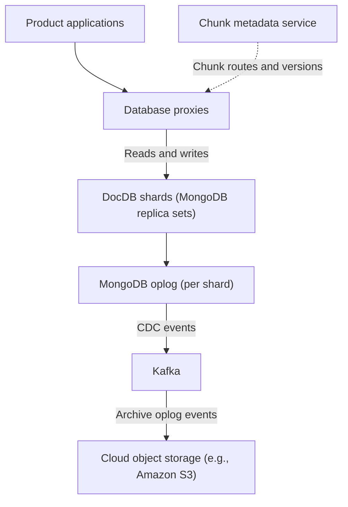

# Learning Notes: Stripe’s Document Databases and Online Migrations

**Blog:** [How Stripe’s document databases supported 99.999% uptime with zero-downtime data migrations](https://stripe.dev/blog/how-stripes-document-databases-supported-99.999-uptime-with-zero-downtime-data-migrations)  
**Published:** June 6, 2024  
**Further reading:** [Database Sharding: Concepts and Examples — MongoDB](https://www.mongodb.com/resources/products/capabilities/database-sharding-explained)

These notes combine the blog’s design with conceptual explanations from our discussion. Examples and engineering deductions are illustrative.

## 1. Core idea

A growing database needs more than additional machines. It needs a safe way to redistribute existing data while applications continue using it.

Think of a migration as two linked problems:

- **Data movement:** copy existing records and keep up with ongoing changes.
- **Traffic movement:** ensure requests reach the correct location during the transition.

Copying data solves only the first part. A correct migration must coordinate both.

## 2. Terminologies learned

- **Client-transparent migration:** Moving backend data or infrastructure without requiring application developers to change client code, configuration, or connection settings. An intermediary can absorb routing changes internally. Transparency does not guarantee that every individual request has unchanged latency.

- **Online data migration:** Moving data while the application continues serving users. A typical approach copies an initial snapshot, applies subsequent changes, and switches traffic when the destination is ready.

- **Oplog:** MongoDB’s operations log: a special capped collection containing a rolling record of data modifications. Replica-set members use it to replicate changes. It has a retention window; it is not a permanent history of all writes. Read-only queries are not its purpose. See [MongoDB’s oplog documentation](https://www.mongodb.com/docs/manual/core/replica-set-oplog/).

- **Change Data Capture (CDC):** Detecting database changes and making them available to other systems. Changes commonly include inserts, updates, and deletes. CDC can keep a destination updated without repeatedly copying the full source dataset.

- **Failover:** Switching service to a healthy replacement when the current serving component becomes unavailable, or intentionally switching it during maintenance. In a MongoDB replica set, eligible members elect a new primary when necessary.

- **Scale out / scale in:** Adding / removing machines or shards. Both are forms of horizontal scaling. Database scaling usually requires redistributing data as capacity changes. Scale up / scale down means increasing / decreasing resources on existing machines.

- **Batching writes:** Sending multiple write operations together instead of submitting each separately. This reduces per-request overhead and can improve throughput. A batch is not automatically an atomic transaction.

- **Point-in-time snapshot:** A consistent view of data as it existed at a particular moment, T. Creating that view and copying its contents are separate operations: copying can take hours while the view still represents time T.

- **Versioned gating:** Attaching versions to requests and checking them at the serving system to accept or reject access. During migration, this can reject requests from proxies whose routing information is stale.

- **Fork-lifting:** Moving data into a separate deployment running a newer database version, then switching traffic to it. The upgrade happens through migration rather than by upgrading the existing deployment in place.

### Supporting terms

- **Sharding:** Dividing a dataset into portions stored across multiple shards, distributing storage and processing load.
- **Chunk:** A unit of data placement and migration.
- **Replica set:** Nodes maintaining copies of the same dataset, with a primary and secondary members.
- **Replication lag:** How far a replica or migration destination trails the source.
- **Checkpoint:** A recorded progress position from which processing can resume.
- **Multitenancy with enforced quotas:** Sharing infrastructure while the platform applies per-tenant resource limits, helping contain noisy neighbors.
- **Write locality / proximity of writes:** Consecutive writes affecting nearby storage or index pages, allowing better reuse of pages in memory.

## 3. Stripe’s design at a glance

Stripe built DocDB around MongoDB Community. Its proxies route queries using a chunk metadata service; shards are replica sets. The Data Movement Platform coordinates migrations. Its CDC path carries oplog events through Kafka into object storage such as S3.

### Architecture

The diagram shows the application request path and the CDC pipeline:

During migration, the async replication service reads oplog events from Kafka and object storage, then applies changes for the selected chunks to destination shards. Archiving provides change history for replay beyond the source oplog’s finite retention window. [Source: Stripe blog](https://stripe.dev/blog/how-stripes-document-databases-supported-99.999-uptime-with-zero-downtime-data-migrations)

### Migration lifecycle

| Migration step | What happens |
|---|---|
| Register | Record migration intent and build destination indexes. |
| Bulk import | Copy selected data from a snapshot at T. |
| Replicate | Replay changes from T; support checkpoints, lag tracking, and reverse replication for rollback. |
| Verify | Compare point-in-time snapshots for correctness. |
| Switch | Fence source requests, drain outstanding changes, then publish the destination route and version. |
| Complete | Mark completion and remove source data. |

Replication writes are tagged to prevent cycles. The reported switch takes under two seconds; rejected requests succeed on retries. Sorted bulk insertion improved throughput 10×. The platform also supports consolidation and database-version upgrades. [Source: Stripe blog](https://stripe.dev/blog/how-stripes-document-databases-supported-99.999-uptime-with-zero-downtime-data-migrations)

## 4. Why collections are sharded

A collection is a logical grouping of documents. It does not need to fit on one machine.

For example, a large `payments` collection could be partitioned by merchant:

| Logical collection | Illustrative partition | Location |
|---|---|---|
| payments | Merchants A–F | Shard 1 |
| payments | Merchants G–P | Shard 2 |
| payments | Merchants Q–Z | Shard 3 |

This can distribute storage, CPU, and disk I/O. A query for one merchant may target one shard, while a query covering all merchants may require several.

Sharding adds routing and operational complexity. Replication serves a different purpose: it maintains copies of data for availability and potentially read capacity. A system can use both. [Further reading: MongoDB sharding](https://www.mongodb.com/resources/products/capabilities/database-sharding-explained)

The requirement to support sharding should be read alongside the other DBaaS requirements. MongoDB has native sharding; the presence of that bullet does not establish that sharding itself was the missing capability.

## 5. How CDC supports online migration

### Log-based change detection

A database records modifications in an internal log. A log-based CDC system consumes those records and exposes them for downstream processing.

For example:

| Source operation | Captured change |
|---|---|
| Create payment p1 | Insert |
| Change p1 from pending to succeeded | Update |
| Remove payment p2 | Delete |

The oplog supplies the change history; CDC transports or exposes it; a replication consumer applies relevant changes to the destination. These are related responsibilities, rather than interchangeable names.

### Snapshot plus change replay

Suppose the initial snapshot represents **10:00 AM**, and its import finishes at **11:00 AM**.

During that hour, new payments arrive and existing payments change status. The destination therefore needs:

**Destination state = snapshot at T + correctly applied changes since T.**

At implementation level, the snapshot position and replay boundary must align so changes are neither missed nor applied incorrectly. Ordering and safe handling of retries also matter.

A snapshot supplies the baseline. CDC supplies ongoing changes. Neither alone completes a live migration.

### Why retain change history externally?

An oplog has a finite history window. If a long-running consumer falls behind that window, the source log may no longer contain everything it needs.

Keeping a durable change history can support replay and recovery beyond that window. Log retention, consumer progress, and checkpoints are therefore important design considerations.

## 6. Why sorted insertion can improve bulk imports

A database insert also updates relevant indexes. In a B-tree, nearby keys tend to occupy the same or neighboring pages.

Consider a simplified index:

| Page | Example key range |
|---|---|
| A | 1–100 |
| B | 101–200 |
| C | 201–300 |

An unsorted sequence such as `15, 250, 120, 18, 260, 130` visits pages in the order `A, C, B, A, C, B`.

Sorting it to `15, 18, 120, 130, 250, 260` gives `A, A, B, B, C, C`.

When the working set exceeds available cache, repeatedly jumping between pages can cause extra loading, eviction, and writing. Sorted insertion groups work on nearby pages, improving locality.

Important distinctions:

- **Batching** reduces request overhead.
- **Sorting** changes how writes access storage and indexes.
- One insertion order may help some indexes more than others.
- Nearby B-tree pages do not guarantee consecutive physical disk locations.
- A measured speedup is workload-specific, not a universal guarantee.

**Learning:** Understand the underlying data structure before assuming configuration tuning will solve a performance bottleneck.

## 7. Why versioned gating is necessary

Updating a routing directory does not instantly update every proxy’s cached routing information.

Consider an illustrative migration with request version `7`:

1. Proxies send requests for the chunk to source A.
2. The source gate advances, rejecting requests carrying the old version.
3. Outstanding source changes finish replicating to destination B.
4. Metadata publishes B’s location and the updated version.
5. Proxies refresh their routes and retry against B.

Without source-side enforcement, an outdated proxy could keep sending writes to A while another writes to B.

**Learning:** A routing update tells clients where to go. A gate enforces whether an old route is still usable.

The version values are illustrative; this is a conceptual explanation, not a specification of Stripe’s exact token-comparison implementation.

## 8. Availability and operational lessons

### Online, transparent, and uninterrupted describe different properties

| Property | Question it answers |
|---|---|
| Online | Can the application continue serving users during migration? |
| Client-transparent | Must the application change its code or configuration? |
| Request continuity | Does an individual request pause, retry, or fail? |

An online, transparent migration can still include brief internal request rejection. Successful retries can absorb that interruption within the application’s latency and retry budgets.

## 9. Takeaways to remember

- A logical collection can span multiple physical locations.
- Online migration combines a stable snapshot, change replay, verification, and a controlled traffic switch.
- CDC lets downstream systems follow changes without repeatedly copying everything.
- Insertion order can materially affect storage efficiency.
- Version checks protect against stale routing.
- Safe data movement enables scaling, consolidation, and infrastructure replacement.
- Reliability depends on coordinating data, routing, retries, and recovery—not just copying records.

## References

1. [Stripe — Document databases and zero-downtime data migrations](https://stripe.dev/blog/how-stripes-document-databases-supported-99.999-uptime-with-zero-downtime-data-migrations)
2. [MongoDB — Database Sharding: Concepts and Examples](https://www.mongodb.com/resources/products/capabilities/database-sharding-explained)
3. [MongoDB — Replica Set Oplog](https://www.mongodb.com/docs/manual/core/replica-set-oplog/)

